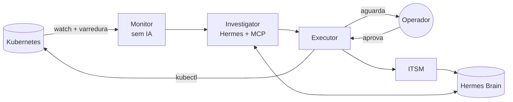

<div align="center">

# Hermes Sentinel

**AIOps para Kubernetes com um time de agentes, aprovação humana e memória que aprende.**

[](https://github.com/MathZiraA/Hermes-Sentinel-AIOps/actions/workflows/ci.yml)
[](LICENSE)


[Documentação](docs/README.md) · [Arquitetura](docs/architecture/overview.md) · [Roadmap](ROADMAP.md) · [Changelog](CHANGELOG.md)

</div>

---

O Hermes Sentinel vigia um cluster Kubernetes, detecta **qualquer** comportamento fora do normal, investiga a causa
raiz com um agente de IA e propõe a correção. **Nada muda no cluster sem o clique de um humano.** Cada incidente e
cada decisão viram memória num vault Obsidian, e o time de agentes usa essa memória nos próximos casos.

Quem entende de Kubernetes vê os comandos, os logs e as evidências. Quem não entende acompanha cinco agentes num
escritório isométrico, explicando tudo em português simples.

## Destaques

- **Detecção abrangente e sem custo de IA.** Pods, nós, deployments, statefulsets, jobs, volumes, HPAs, eventos e
  memória perto do limite. Motivos desconhecidos viram incidente com o próprio nome. Com o cluster saudável, nenhuma
  chamada de IA.
- **Investigação agêntica.** O Hermes escolhe o que ler (logs, eventos, recursos, nós, métricas, memória) por
  ferramentas MCP somente leitura, e devolve causa, evidências, confiança e ação recomendada.
- **Humano no controle.** Lista fechada de ações, comando exato na tela e aprovação obrigatória. Uma ação desconhecida
  vinda da IA vira "correção manual".
- **Menor privilégio de verdade.** Cada bot tem token próprio, e o servidor confere o papel a cada chamada.
- **Memória que aprende.** O Hermes Brain liga incidentes, serviços, padrões, runbooks e lições humanas num grafo do
  Obsidian. O motivo de cada aprovação ou rejeição ensina o time.
- **Correlação.** Vários sinais do mesmo workload viram um único incidente.
- **Pronto para empresa.** Login com 2FA e SSO, papéis com escopo por time, SEV1–SEV4 com SLA, auditoria imutável e
  um painel responsivo em português e inglês, com tema escuro e claro.

## Como funciona



| Agente | Faz |
|---|---|
| **Monitor** | Detecta anomalias de forma determinística ([catálogo](docs/architecture/overview.md#catálogo-de-detecção)) |
| **Supervisor** | Coordena o fluxo e traduz o incidente para quem não é técnico |
| **Investigator** | O Hermes investiga pelo MCP, com a memória do time, e devolve a causa raiz |
| **Executor** | Prepara a correção e só aplica depois da aprovação humana |
| **ITSM** | Registra o incidente no Hermes Brain (e no GitHub, se configurado) |

Detalhes em [docs/architecture/overview.md](docs/architecture/overview.md).

## Instalação

| Onde | Como | Guia |
|---|---|---|
| Kubernetes (produção) | Helm chart: central + agente por cluster | [deploy-helm.md](docs/operations/deploy-helm.md) |
| Uma VM | Docker Compose (PostgreSQL, backend, interface e proxy) | [deploy-compose.md](docs/operations/deploy-compose.md) |
| Desenvolvimento | `make setup && make dev` | [installation.md](docs/operations/installation.md) |

```bash
git clone https://github.com/MathZiraA/Hermes-Sentinel-AIOps.git
cd Hermes-Sentinel-AIOps
make setup      # venv do backend, dependências do frontend, .env
make dev        # backend :8000 + frontend :3000
```

Abra http://localhost:3000, crie o administrador na primeira tela e, na **Sala de guerra**, clique em
**Simular Incidente**. Para ligar a um cluster real e ao Hermes, siga o
[guia de instalação](docs/operations/installation.md) e o [ambiente de demonstração](docs/operations/demo-environment.md).

| Comando | O que faz |
|---|---|
| `make check` | lint, tipos e testes (o mesmo que o CI) |
| `make format` | formata backend e frontend |
| `make audit` | vulnerabilidades conhecidas nas dependências |
| `make openapi` | exporta o contrato da API |

## Stack

| Camada | Tecnologia |
|---|---|
| Backend | Python 3.12+, FastAPI, cliente oficial do Kubernetes, SDK MCP |
| Frontend | React 19, TanStack Start/Router/Query, Tailwind, Recharts, cena isométrica em CSS 3D |
| Dados | PostgreSQL (SQLite na demo), SQLAlchemy 2, Alembic |
| Identidade | Sessões HttpOnly, argon2id, TOTP, OIDC |
| IA | Hermes Agent (gateway OpenAI-compatível) + Gemini |
| Memória | Obsidian (Markdown + wikilinks) |
| Distribuição | Docker (imagens sem root), Docker Compose + Caddy, Helm chart, métricas Prometheus |
| Qualidade | pytest, Vitest, ruff, ESLint, Prettier, pip-audit, gitleaks, kubeconform, GitHub Actions |

## Estrutura do repositório

```
├── backend/               API FastAPI, Monitor, orquestrador, servidor MCP, Hermes Brain
│   ├── agent/             agente de cluster remoto (python -m agent)
│   ├── api/               rotas REST por área
│   ├── db/ · migrations/  modelos, repositórios e migrações Alembic
│   ├── domain/            regras puras: ciclo de vida, SLA, ações, permissões
│   ├── identity/          login, sessões, 2FA, OIDC
│   ├── agents/            orquestração dos cinco agentes
│   ├── integrations/      Hermes, Hermes Brain, Obsidian, GitHub
│   ├── k8s/               cliente e Monitor (watch + varredura)
│   ├── schemas/           contratos de eventos e incidentes
│   └── tests/
├── src/                   frontend (React + TanStack Start, criado no Lovable)
├── deploy/                Docker Compose (+ Caddy) e Helm chart
├── docs/                  arquitetura, ADRs, operação, segurança, manual, API
├── obsidian-vault/        Hermes Brain (só os runbooks oficiais são versionados)
├── scripts/               instalação e desenvolvimento
└── .github/               CI, templates de issue e PR, Dependabot
```

## Status

Versão **1.0.0**: produto self-hosted completo: login com 2FA e SSO, papéis com escopo por time, PostgreSQL,
SEV/SLA, auditoria imutável, plantão, autorremediação controlada, Jira, Zabbix, Grafana, Loki, provedor de IA
trocável com orçamento, multicluster por agente, Helm e Docker Compose. O que veio em cada fase está no
[ROADMAP](ROADMAP.md) e no [CHANGELOG](CHANGELOG.md).

## Contribuindo e segurança

Leia o [CONTRIBUTING](CONTRIBUTING.md) antes de abrir um PR. Vulnerabilidades devem ser relatadas em privado, conforme
o [SECURITY.md](SECURITY.md).

## Licença

[MIT](LICENSE) © 2026 Matheus Maciel Ziravello. O frontend nasceu no [Lovable](https://lovable.dev).
