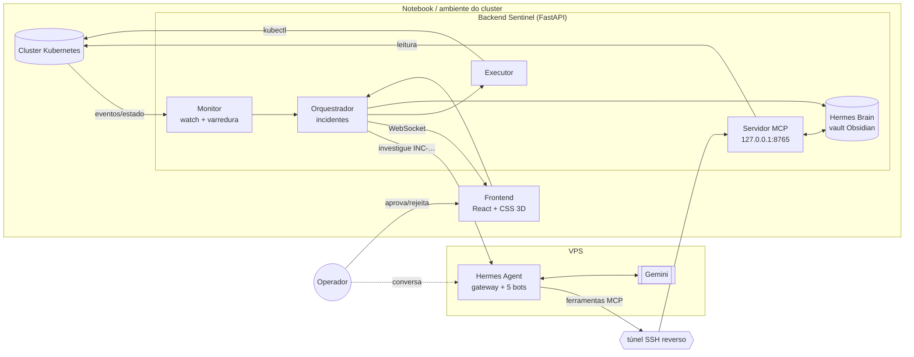
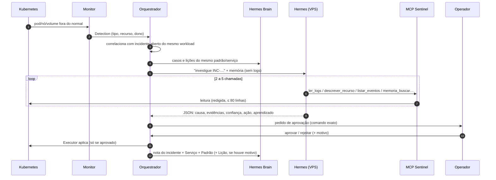

# Arquitetura

Este documento descreve como o Hermes Sentinel funciona hoje (`0.1.x`). As decisões por trás de cada escolha estão nos
[ADRs](adr/). O que muda nas próximas versões está no [ROADMAP](../../ROADMAP.md).

## Visão geral

## Componentes

| Componente | Onde | Responsabilidade |
|---|---|---|
| **Monitor** (`k8s/watcher.py`) | backend | Detecta anomalias sem IA: watch de Pods e varredura a cada 30 s. Ver [catálogo](#catálogo-de-detecção). |
| **Orquestrador** (`agents/orchestrator.py`) | backend | Abre incidentes, correlaciona sinais, conduz o fluxo e anima os agentes na UI. |
| **Cliente Hermes** (`integrations/hermes_client.py`) | backend | Pede a investigação ao Hermes; aplica fallback (diagnóstico com logs no prompt → runbook local). |
| **Servidor MCP** (`mcp_server.py`) | backend | Ferramentas que o Hermes usa no cluster e na memória, com token por bot e permissões por papel. |
| **Executor** | backend | Aplica a correção aprovada (`rollout restart`, `scale`, `delete pod`). |
| **Hermes Brain** (`integrations/brain.py`) | backend + Obsidian | Memória do time: incidentes, padrões, serviços, lições, runbooks e diários. |
| **Frontend** (`src/`) | navegador | Escritório isométrico, Kanban, banner de aprovação, painel de conexões. |
| **Hermes Agent** | VPS | Raciocínio (Gemini) e os 5 bots (profiles) acessíveis pelo Hermes Desktop. |

## Fluxo de um incidente

Se o Hermes estiver fora, ocupado (429/503) ou o túnel cair, o Investigator cai para o diagnóstico com logs no prompt
e, por último, para um RCA local baseado em regras e runbooks. A UI nunca trava. Para tipos de falha sem regra
conhecida, o fallback recomenda `none` (correção manual).

## Catálogo de detecção

| Fonte | Regra | Tipo do incidente |
|---|---|---|
| Container | `OOMKilled`, ou `exit 137` com limite de memória | `OOMKilled` |
| Container | qualquer motivo de espera fora de `ContainerCreating`/`PodInitializing` | o próprio motivo (`CrashLoopBackOff`, `CreateContainerConfigError`, …) |
| Pod | fase `Failed` | `status.reason` (`Evicted`, …) ou `PodFailed` |
| Pod | `Pending` sem nó há mais de 2 min | `FailedScheduling` |
| Pod | `Running`, mas não pronto há mais de 3 min | `NotReady` |
| Nó | `Ready != True` · `Memory/Disk/PIDPressure` | `NodeNotReady` · `Node<Pressão>` |
| Deployment | `ProgressDeadlineExceeded` · 0 réplicas disponíveis há mais de 3 min | o motivo · `DeploymentDown` |
| StatefulSet | menos réplicas prontas que o desejado | `StatefulSetDegraded` |
| Job | condição `Failed` | `JobFailed` |
| PVC | `Lost` · `Pending` há mais de 2 min | `PVCLost` · `PVCPending` |
| HPA | réplicas atuais = máximo | `HPAMaxedOut` |
| Evento | Warning repetido (≥ 3x) não coberto acima | o motivo do evento (`FailedMount`, …) |
| Métricas | memória ≥ 90% do limite | `MemoryNearLimit` |

Pods sendo apagados são ignorados. O mesmo sinal tem 10 min de dedupe, e sinais do mesmo workload entram no incidente
já aberto como "sinais correlacionados".

## Modelo de segurança

Resumo; detalhes em [threat-model.md](../security/threat-model.md).

- Nenhuma alteração no cluster sem aprovação ([ADR 0003](adr/0003-aprovacao-humana.md)).
- MCP só em `127.0.0.1`, com Bearer e token por bot ([ADR 0004](adr/0004-hermes-via-mcp-e-tunel.md),
  [ADR 0005](adr/0005-menor-privilegio-por-bot.md)).
- Logs e eventos redigidos e marcados como não confiáveis; Secrets nunca são lidos; ConfigMaps só mostram as chaves.

## Persistência

Incidentes, linha do tempo, clusters e auditoria ficam no banco (PostgreSQL em produção, SQLite na demo), com
migrações Alembic aplicadas na subida. Detalhes e motivos no [ADR 0008](adr/0008-persistencia-ciclo-de-vida-auditoria.md).

## Limitações conhecidas (0.1.x)

- Sem login nem papéis de usuário na interface (Fase 2).
- Um cluster por instalação (Fase 7).
